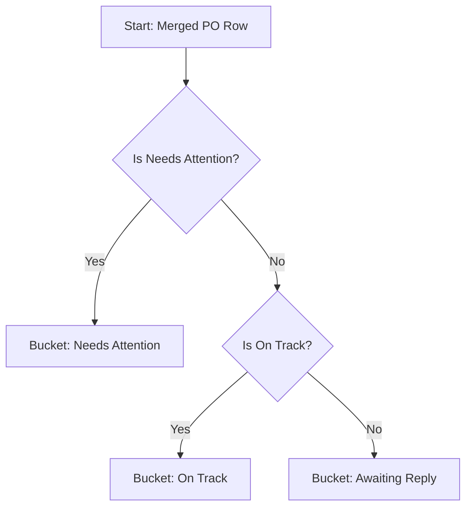

# PO Categorization Logic Documentation

This document explains how Purchase Orders (POs) are retrieved, merged, and categorized into status buckets on the main summary page of the dashboard.

---

## 1. System & Architecture Overview

The dashboard's PO classification system is split between a Google Apps Script backend and a React frontend:

1. **Google Sheets (Data Layer)**: The raw data is stored in Google Sheets. The two primary sheets involved in PO tracking and status categorization are:
   - **`PO consolidated data`**: Contains master purchase order records (e.g., PO numbers, material details, quantities, need-by dates).
   - **`Communication Logs`**: Contains AI and agent communication states, supplier replies, and classification statuses.
2. **Google Apps Script (API/Backend Layer)**: Exposes a `doGet` endpoint with `action=dashboard`. It fetches data from both sheets, joins them by `po_line_key`, filters by the user's `client_code`, performs server-side categorization, and returns a JSON payload containing the merged records.
3. **React Frontend (Presentation/Filtering Layer)**: Receives the full list of open POs from the API. Rather than relying solely on the backend's categorization arrays, the frontend uses a client-side utility ([utils.js](file:///c:/Users/Mrunmayee/OneDrive/Desktop/AKISTO-ALL/akisto-dash-v3/dash-front/react-front/src/utils.js)) to dynamically sort, filter, and categorize each PO in real-time. This ensures that when a user searches or sorts, the active tab counts and row allocations update dynamically.

---

## 2. Google Sheets Schema & Column Reference

The categorization logic uses specific columns from both sheets. Below is a mapping of the columns accessed:

### A. From `PO consolidated data` Sheet
These columns represent the core transactional details of each order:

| Column Name | JSON Property | Description |
| :--- | :--- | :--- |
| `po_line_key` | `po_line_key` | **Primary Key** used to join the two sheets. |
| `po_number` | `po_number` | Purchase Order Number. |
| `po_line_item` | `po_line_item` | Line item number within the PO. |
| `supplier_name` / `supplier_code` | `supplier_name` / `supplier_code` | Identifies the supplier. |
| `material_code` | `material_code` | SKU / Part number. |
| `material_name` | `material_name` | Description of the material. |
| `quantity` / `qty` | `quantity` / `qty` | Order volume. |
| `unit_of_measure` / `uom` | `unit_of_measure` / `uom` | Unit designation (e.g. EA, KG). |
| `deliver_by_date_delivery_1` | `deliver_by_date_delivery_1` | The target delivery date requested by the buyer. |
| `ship_by_date_delivery_1` | `ship_by_date_delivery_1` | The target ship-by date (displayed when PO is On Track). |

### B. From `Communication Logs` Sheet
These columns track the state of the AI outreach and supplier follow-ups:

| Column Name | JSON Property | Description |
| :--- | :--- | :--- |
| `follow_up_stage` | `follow_up_stage` | The active follow-up stage (e.g., `Stage1`, `Stage1.5`, `Stage2`, `Stage2.5`, `Stage3`). |
| `follow_up_status` | `follow_up_status` | The communication state (e.g., `outreach_sent`, `replied`, `Clarification_Sent`, `escalation_sent`). |
| `needs_human_review` | `needs_human_review` | Set to `"yes"` if the AI or a user flagged the PO for manual buyer review. |
| `human_review_status` | `human_review_status` | Set to `"pending"` if human evaluation is currently outstanding. |
| `[stage_prefix]_delivery_status_classification` | `[stage_prefix]_delivery_status_classification` | AI-classified status for the active stage (e.g. `stage1_delivery_status_classification`). |
| `[stage_prefix]_supplier_reply_confidence` | `[stage_prefix]_supplier_reply_confidence` | AI's confidence score for classification (`low` triggers review). |
| `[stage_prefix]_delivery_status_text` | `[stage_prefix]_delivery_status_text` | Text describing the delivery status (displayed under "What's happening"). |
| `[stage_prefix]_reply_timestamp` | `[stage_prefix]_reply_timestamp` | Timestamp of the supplier's latest reply in the active stage. |
| `[stage_prefix]_supplier_reply_status` | `[stage_prefix]_supplier_reply_status` | Status of supplier reply (`received` indicates a reply has arrived). |
| `supplier_colleague_email` | `supplier_colleague_email` | Target email if the PO was delegated to a colleague. |
| `promised_revert_date` | `promised_revert_date` | The date the supplier promised to provide their next update. |
| `latest_update_text` | `latest_update_text` | Latest textual status update captured. |
| `latest_update_timestamp` | `latest_update_timestamp` | Timestamp of the latest update. |
| `next_action` | `next_action` | The next scheduled automated action (displayed as "Next touch point"). |

> [!NOTE]
> The code constructs a dynamic prefix from the current stage. For example, if `follow_up_stage` is `'Stage2.5'`, the code formats it to `'stage2_5_'` to target `stage2_5_delivery_status_classification`.

---

## 3. The 3 main Categorization Buckets

The frontend utility function [resolvePoDashboardState(po)](file:///c:/Users/Mrunmayee/OneDrive/Desktop/AKISTO-ALL/akisto-dash-v3/dash-front/react-front/src/utils.js#L83-L221) processes each merged PO object and determines which tab bucket it falls into.



---

### Category A: Needs Attention

This bucket highlights orders that require manual intervention by the buyer. It has the highest priority: if a PO meets any "Needs Attention" criteria, it is immediately routed here.

#### 1. Trigger Logic
A PO is placed in **Needs Attention** if **any** of the following evaluate to true:
- `needs_human_review` is `"yes"` (case-insensitive, trimmed)
- `human_review_status` is `"pending"` (case-insensitive, trimmed)
- `follow_up_status` is `"escalation_sent"` (case-insensitive, indicating a non-responsive supplier)
- The active stage's classification matches `"delayed"` or `"delayed tbc"`
- The active stage's classification confidence is `"low"`

#### 2. Sub-status Resolution & UI Presentation
Once categorized under Needs Attention, the sub-status, label, and reason displayed in the table are determined as follows:

| Sub-status | Condition | UI Label | CSS Class | Color / Pill Style | Default Reason Text |
| :--- | :--- | :--- | :--- | :--- | :--- |
| **Unclear Response** | Classification is exactly `'unclear'` | `"Unclear response"` | `p-unclear` | Purple fill / purple text | Stage-specific delivery status text, or fallback: *"AI clarification attempts failed or unclear response received."* |
| **Low Confidence** | Supplier reply confidence is `'low'` | `"Low confidence"` | `p-low-confidence` | Light canvas bg / gray-brown text | Stage-specific delivery status text, or fallback: *"AI classification confidence is Low; review required."* |
| **Delayed** | Classification matches `"delayed"` | `"Delayed"` | `p-delayed` | Red fill / red text | Stage-specific delivery status text, or fallback: *"Delivery delayed."* |
| **Delayed TBC** | Classification matches `"delayed tbc"` | `"Delayed · TBC"` | `p-delayed-tbc` | Red fill / red text | Stage-specific delivery status text, or fallback: *"Delivery delayed (TBC)."* |
| **No Response** | Status is `'escalation_sent'` | `"No Response"` | `p-no-response` | Gold fill / dark gold text | *"No reply despite repeated follow-up emails and calls."* |
| **Needs Review** (Fallback) | Any other trigger (e.g. manual `needs_human_review === 'yes'`) | `"Needs review"` | `p-review` | Slate gray pill (`#F1F5F9` bg, `#475569` text) | Stage-specific delivery status text, or fallback: *"Flagged for reviewer audit."* |

---

### Category B: On Track

This bucket contains orders that are progressing successfully without requiring buyer intervention.

#### 1. Trigger Logic
A PO is classified as **On Track** if it does not qualify for "Needs Attention", and matches the active-stage schedule confirmation rules:
- **Active Stages** (`Stage1`, `Stage2`, `Stage3`): The active stage classification must be one of: `['on time', 'on time tbc']`.
- **Passive Stages** (`Stage1.5`, `Stage2.5`):
  - If **no reply** has been received yet (quiet monitoring phase), it is automatically classified as **On Track** (mapping to `"On time"`).
  - If a **reply has been received**, its active classification must be one of: `['on time', 'on time tbc']`.

#### 2. Sub-status Resolution & UI Presentation
On-track items are broken down into status variations (only two UI categories exist):

| Classification | Sub-status | UI Label | CSS Class | Color / Pill Style | Default Reason Text |
| :--- | :--- | :--- | :--- | :--- | :--- |
| Classification contains `'tbc'` | `Confirmed` | `"On time · TBC"` | `p-tbc` | Light green fill / green text | Stage-specific delivery status text, or fallback: *"Delivery is currently on schedule."* |
| Standard confirmed on-time OR Passive stage with no reply (Stage 1.5 / 2.5) | `Confirmed / Monitoring` | `"On time"` | `p-ontime` | Light green fill / green text | Stage-specific delivery status text, or fallback: *"Delivery is currently on schedule."* |

---

### Category C: Awaiting Reply

This bucket captures orders that are currently in communication, where the buyer is chasing the supplier for updates, or where a reply has been received and is waiting to be processed.

#### 1. Trigger Logic
A PO falls into **Awaiting Reply** if it is neither "Needs Attention" nor "On Track". This happens when:
- The communication status indicates active chasing (`outreach_sent`, `reminder1_sent`, `reminder2_sent`, `reminder3_sent`).
- The status is `Clarification_Sent` (awaiting details on an ambiguous reply).
- The classification is `awaiting_reply`.
- The PO is in a passive stage (`Stage1.5` or `Stage2.5`) and has received a reply, but the classification is not finalized.

#### 2. Sub-status Resolution & UI Presentation
Awaiting Reply items are presented with details about who is being chased and when they are scheduled to be contacted:

| Sub-status | Condition | UI Label | CSS Class | Color / Pill Style | Default Reason Text |
| :--- | :--- | :--- | :--- | :--- | :--- |
| **Clarification in progress** | status is `'Clarification_Sent'` | `"Awaiting Clarification"` | `p-await` | Soft blue fill (`#EAF0FB` bg, `#3A5C9A` text) | *"Waiting for clarification"* |
| **Delegated to Colleague** | Classification is `'awaiting_reply'` AND `supplier_colleague_email` is populated | `"Awaiting reply"` | `p-await` | Soft blue fill | *"Chasing colleague: [email]"* |
| **Promised Check Date** | Classification is `'awaiting_reply'` AND a revert date exists | `"Awaiting reply"` | `p-await` | Soft blue fill | *"Awaiting promised update on [formatted date]"* or *"Awaiting promised check"* |
| **Awaiting Reply** | Passive stage with reply received but classification pending | `"Awaiting reply"` | `p-await` | Soft blue fill | Stage-specific delivery status text, or fallback: *"Waiting for reply classification."* |

---

## 4. Frontend Computation Details

### A. Dynamic Date Headers
Depending on the category tab, different date columns are pulled from the PO data:
- **`On Track` Tab**: Displays the **`Ship-by`** date (mapping to `ship_by_date_delivery_1`).
- **All other Tabs (`Open POs`, `Needs attention`, `Awaiting reply`)**: Display the **`Need by`** date (mapping to `deliver_by_date_delivery_1`).

### B. Quantity Formatting
The quantity column is formatted using:
```javascript
export function quantityText(po) {
  return `${po.quantity || po.qty || '--'} ${po.unit_of_measure || po.uom || ''}`.trim();
}
```
This joins the numeric quantity value with its unit of measure (e.g. `500 EA`).
