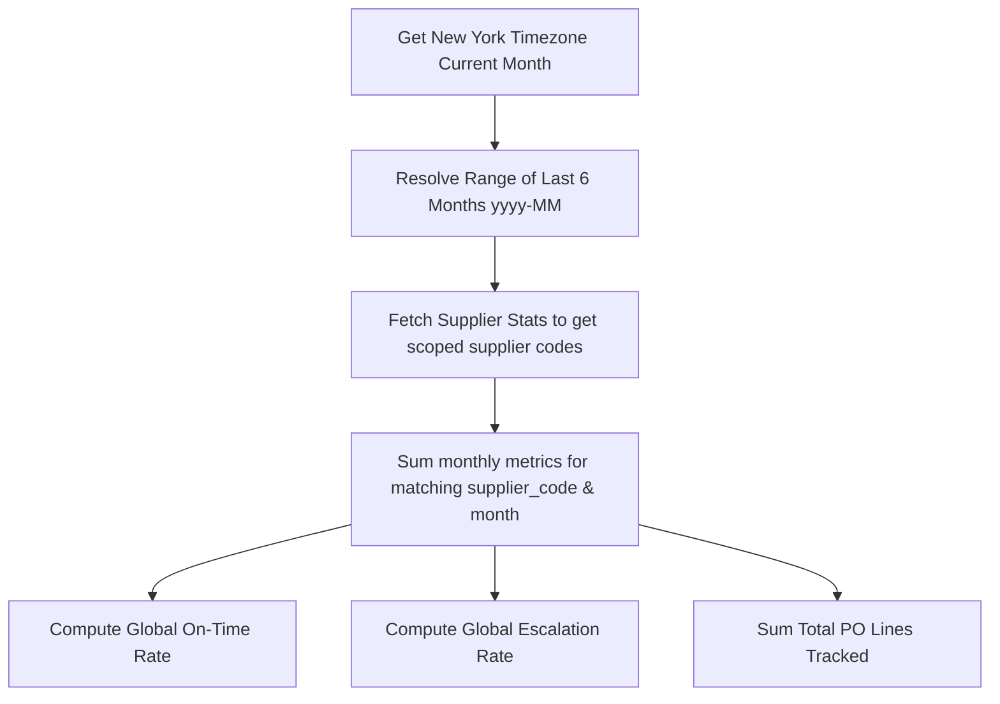

# Supplier Performance Page Documentation: Core KPIs & Trend Graph

This document details the data sources, calculations, and rendering logic for the main metrics and historical trend graph shown on the **Supplier Performance** page.

---

## 1. Mapped Google Sheets & Columns

The performance dashboard reads from four sheets in the Google Sheets database:

### A. Sheet: `Supplier Stats`
Used to resolve the list of active suppliers scoped to the logged-in user's client (and buyer portfolio, if applicable).

| Column Name | JSON Property | Description |
| :--- | :--- | :--- |
| `client_code` | `s.client_code` | Used to filter data for the active client session. |
| `supplier_code` | `s.supplier_code` | The identifier code of the supplier. |
| `buyer_name` | `s.buyer_name` | (Node.js Backend only) Used to scope suppliers to the logged-in buyer. |

### B. Sheet: `Supplier Monthly Stats`
The primary source of historical transactional metrics.

| Column Name | JSON Property | Description |
| :--- | :--- | :--- |
| `client_code` | `row.client_code` | Used to filter data for the active client. |
| `supplier_code` | `row.supplier_code` | Set to `"GLOBAL"` (for global trend line fallback) or matching supplier codes. |
| `month` | `row.month` | Calendar month in format `YYYY-MM` (e.g. `2026-05`). |
| `total_po_lines` | `row.total_po_lines` | Cumulative PO line items tracked for the supplier/global in that month. |
| `on_time_lines` | `row.on_time_lines` | PO lines completed on or before schedule in that month. |
| `escalated_lines` | `row.escalated_lines` | PO lines escalated in that month. |
| `on_time_rate` | `row.on_time_rate` | Pre-calculated monthly OTR percentage (used in global fallback). |

### C. Sheet: `Client Stats`
Provides the reference delta statistics for the client company.

| Column Name | JSON Property | Description |
| :--- | :--- | :--- |
| `client_code` | `cs.client_code` | Filters stats for the active client. |
| `client_otr_6months` | `kpis.onTimeRateDelta` | The percentage change in the client's global On-Time Rate compared to the previous 6-month period. |
| `client_escalation_6months` | `kpis.escalatedRateDelta` | The percentage change in the client's global Escalated Rate compared to the previous 6-month period. |

---

## 2. Core KPI Card Logic

The core KPI cards—**On-time rate**, **Escalated to buyer**, and **PO lines tracked**—are computed dynamically for the **last 6 months** ending in the current month of the login/run date.



### A. TRAILING 6-MONTH MONTH RESOLUTION
To avoid date rollover issues, the system locks the day of the month to `15` and generates month strings in the `America/New_York` timezone:
- **Apps Script**:
  ```javascript
  var getNewYorkMonthsRange = function(numMonths) {
    var months = [];
    var d = new Date();
    d.setDate(15);
    for (var i = 0; i < numMonths; i++) {
      months.push(Utilities.formatDate(d, "America/New_York", "yyyy-MM"));
      d.setMonth(d.getMonth() - 1);
    }
    return months;
  };
  ```
- **Node.js Backend**:
  ```javascript
  const getNewYorkMonthsRange = (numMonths) => {
    const months = [];
    const d = new Date();
    d.setDate(15);
    for (let i = 0; i < numMonths; i++) {
      const tzString = d.toLocaleString('en-US', { timeZone: 'America/New_York' });
      const localDate = new Date(tzString);
      const y = localDate.getFullYear();
      const m = String(localDate.getMonth() + 1).padStart(2, '0');
      months.push(`${y}-${m}`);
      d.setMonth(d.getMonth() - 1);
    }
    return months;
  };
  ```

### B. METRICS SUMMATION
1. The backend builds a set of valid `supplier_code` values from the filtered `Supplier Stats` sheet.
2. It iterates through the `Supplier Monthly Stats` rows.
3. For rows where `client_code` matches, `supplier_code` is in the set of scoped suppliers, and the parsed `month` is inside the resolved 6-month array, the backend aggregates the counts:
   - `totalPoLines += row.total_po_lines`
   - `totalOnTimeLines += row.on_time_lines`
   - `totalEscalatedLines += row.escalated_lines`

### C. KPI COMPUTATIONS & DELTAS
* **On-time rate**:
  $$\text{Global On-Time Rate} = \text{Math.round}\left(\frac{\text{totalOnTimeLines}}{\text{totalPoLines}} \times 100\right)$$
  *(Defaults to $100\%$ if `totalPoLines` is zero).*
  - **Delta**: Pulled from `client_otr_6months` (`Client Stats`).
    - UI renders a green upward triangle ($\blacktriangle$) if delta $> 0$.
    - UI renders a red downward triangle ($\blacktriangledown$) if delta $< 0$.
* **Escalated to buyer**:
  $$\text{Global Escalation Rate} = \text{Math.round}\left(\frac{\text{totalEscalatedLines}}{\text{totalPoLines}} \times 100\right)$$
  *(Defaults to $0\%$ if `totalPoLines` is zero).*
  - **Delta**: Pulled from `client_escalation_6months` (`Client Stats`).
    - UI renders a red upward triangle ($\blacktriangle$) if delta $> 0$ (indicating escalations increased, representing negative performance).
    - UI renders a green downward triangle ($\blacktriangledown$) if delta $< 0$ (indicating escalations decreased, representing positive performance).
* **PO lines tracked**:
  $$\text{Total PO Lines} = \text{totalPoLines}$$
  *(Displays the sum of all tracked PO line items during the trailing 6-month window).*

---

## 3. On-Time Delivery Rate Over Time (Trend Graph)

The trend graph represents the month-by-month historical OTR performance across the client's scope.

### A. Monthly Aggregation Logic
1. **Dynamic Buyer/Client Scope**:
   - The backend aggregates performance per month across the scoped suppliers:
     ```javascript
     supplierMonthlyStatsRows.forEach(row => {
       if (cCode === clientCode && assignedSupplierCodes.has(sCode)) {
         var month = formatMonth(row.month);
         monthlyAggregates[month].onTime += row.on_time_lines;
         monthlyAggregates[month].total += row.total_po_lines;
       }
     });
     ```
   - The rate is calculated as:
     $$\text{Monthly Rate} = \text{Math.round}\left(\frac{\text{onTime}}{\text{total}} \times 100\right)$$
2. **Global Fallback**:
   - If no supplier-specific rows match the scope, the backend falls back to the client-wide `"GLOBAL"` OTR trend from the `Supplier Monthly Stats` sheet, normalizing the sheet OTR values:
     ```javascript
     var rawRate = parseFloat(row.on_time_rate || 0);
     var rate = rawRate > 1.5 ? (rawRate / 100) : rawRate;
     ```

### B. Frontend Filtering & Slicing
In **[SupplierPerformance.jsx](file:///c:/Users/Mrunmayee/OneDrive/Desktop/AKISTO-ALL/akisto-dash-v3/dash-front/react-front/src/SupplierPerformance.jsx#L186-L192)**, the frontend sorts the month data chronologically and slices the **last 6 months** to draw the graph:
```javascript
const sorted = [...rawTrendData].sort((a, b) => a.month < b.month ? -1 : a.month > b.month ? 1 : 0);
return sorted.slice(-6);
```

### C. SVG Chart Plotting
The OTR trend is plotted inside an inline SVG view box ($900 \times 260$):
- **X Coordinates**: Plotted linearly from $x=50$ (oldest month) to $x=890$ (latest month).
- **Y Coordinates**: Plotted inversely since SVG coordinates scale downwards ($0$ is top, $260$ is bottom):
  $$\text{Y Coordinate} = 220 - \left(\frac{\text{OTR \%}}{100} \times 200\right)$$
  *(An OTR of $100\%$ plots at $y=20$. An OTR of $0\%$ plots at $y=220$).*
- **Visuals**: Plots coordinates as circles, connects them with an SVG `<polyline>`, and places a translucent SVG shaded polygon fill underneath.
