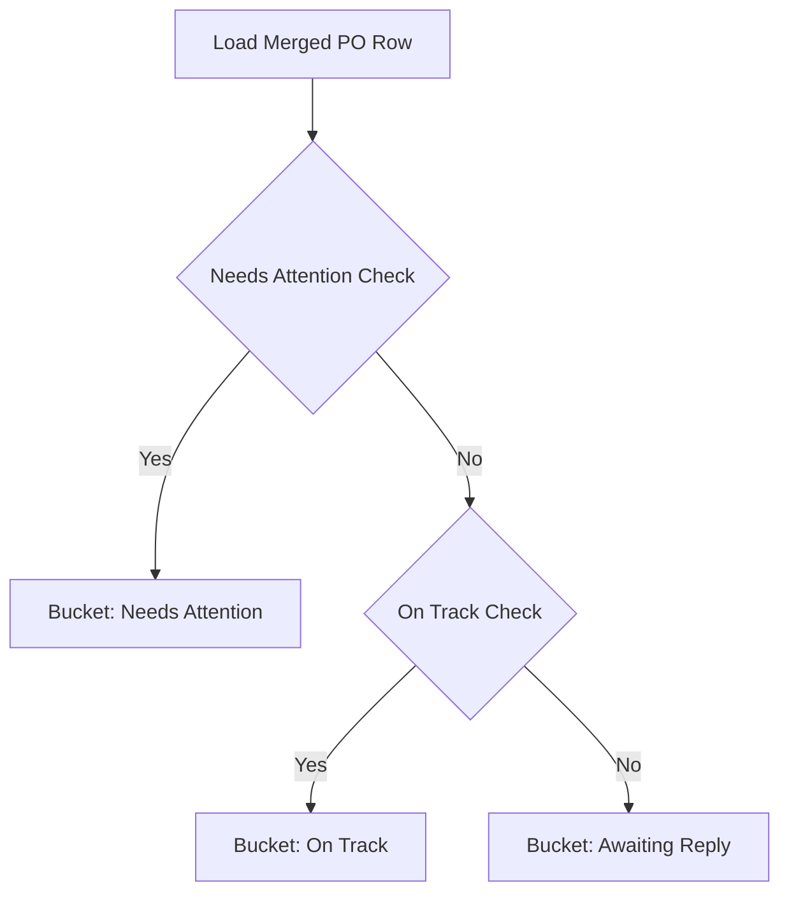

# Purchase Order (PO) Classification & Categorization Logic Documentation

This document provides a detailed technical reference for the classification logic of Purchase Orders (POs) within the Akisto Dashboard. It explains how raw data from [updated sheet.xlsx](file:///c:/Users/Mrunmayee/OneDrive/Desktop/AKISTO-ALL/akisto-dash-v3/dash-front/updated%20sheet.xlsx) is digested, how the backend and frontend determine the status of POs, and how these states map to the dashboard UI.

---

## 1. Overview of the Classification Architecture

The dashboard status classification is computed dynamically across three layers:
1. **Express Backend** ([dashboard.controller.js](file:///c:/Users/Mrunmayee/OneDrive/Desktop/AKISTO-ALL/akisto-dash-v3/dash-front/backend/src/controllers/dashboard.controller.js)): Groups POs into three main buckets (`onTrack`, `needsAttention`, and `awaitingReply`) to structure the API endpoints.
2. **Frontend Router/UI** ([utils.js](file:///c:/Users/Mrunmayee/OneDrive/Desktop/AKISTO-ALL/akisto-dash-v3/dash-front/react-front/src/utils.js)): Replicates and extends the categorization to determine granular UI badges (colors, pills, next action descriptions).
3. **Google Apps Script** ([apps_script.js](file:///c:/Users/Mrunmayee/OneDrive/Desktop/AKISTO-ALL/akisto-dash-v3/dash-front/apps_script.js)): Serves fallback dashboard data directly from the sheets using equivalent classification rules.

---

## 2. Key Sheet Fields Used for Classification

Data is read from the **`PO consolidated data`** and **`Communication Logs`** sheets, merged on the unique key `po_line_key`. The following fields are critical inputs:

| Field Name | Source Sheet | Description | Example Values |
| :--- | :--- | :--- | :--- |
| `follow_up_stage` | `Communication Logs` | The current active stage of communication. | `'Stage1'`, `'Stage1.5'`, `'Stage2'`, `'Stage2.5'`, `'Stage3'` |
| `follow_up_status` | `Communication Logs` | The status of the outreach/reminder sequence. | `'Outreach_Sent'`, `'Reminder1_Sent'`, `'Clarification_Sent'`, `'Escalation_Sent'`, `'Replied'` |
| `needs_human_review` | `Communication Logs` | Flag indicating manual intervention is required. | `'Yes'`, `'No'` |
| `human_review_status` | `Communication Logs` | Status of the pending human audit. | `'Pending'`, `'Resolved'` |
| `[stage]_delivery_status_classification` | `Communication Logs` | AI-classified classification for the specified stage. | `'on time'`, `'on time tbc'`, `'shipped tbc'`, `'Delayed'`, `'awaiting_reply'` |
| `[stage]_supplier_reply_confidence` | `Communication Logs` | Confidence level of the AI classifier for the stage response. | `'High'`, `'Medium'`, `'Low'` |
| `supplier_colleague_email` | `Communication Logs` | Email if the reply indicates delegation. | `'colleague@supplier.com'` |
| `promised_revert_date` | `Communication Logs` | Supplier-specified date they promised to update. | `'2026-07-15'` |

> [!NOTE]
> Active stages (`Stage1`, `Stage2`, `Stage3`) represent active outreach and chasing. 
> Passive stages (`Stage1.5`, `Stage2.5`) represent quiet monitoring phases between milestones, where chasing is paused.

---

## 3. Detailed Classification Rules & Bucketing Logic

The classification algorithm executes a sequential set of conditional checks to place each PO line into one of the three main buckets:



### 3.1 Bucket: Needs Attention (`needsAttention`)
This bucket contains POs that require immediate human reviewer action due to delivery delays, non-responsiveness, low confidence, or unresolved unclear responses.

* **Eligibility Criteria** (Triggers if **ANY** of the following are true for the current stage prefix):
  1. `needs_human_review` is `"Yes"` (case-insensitive) - *often set automatically when AI reply confidence is low.*
  2. `human_review_status` is `"Pending"` (case-insensitive)
  3. `follow_up_status` is `"escalation_sent"`
  4. The current stage's classification (`[stage_prefix]_delivery_status_classification`) contains `"delay"` or `"late"` (case-insensitive)
  5. The current stage's reply confidence (`[stage_prefix]_supplier_reply_confidence`) is `"Low"` (case-insensitive)

* **Sub-status Resolution (The 4 Categories of Needs Attention)**:
  * **`Delayed`** (or `delay vagere`): Triggered when classification contains `"delay"` or `"late"`.
  * **`No Response`**: Triggered when the automated chasing sequence (outreach -> reminders -> calls) is fully exhausted without any reply from the supplier (`follow_up_status` becomes `"escalation_sent"`).
  * **`Unclear Response (after escalation)`**: Triggered when the supplier replied, but the response was `"Unclear"` and the supplier failed to clarify after two automated clarification attempts, prompting n8n to escalate to the buyer (`follow_up_status` becomes `"escalation_sent"`).
  * **`Low Confidence`**: Triggered when the AI parses a response but flags the extraction confidence as `"Low"`.

* **Workflow Action (Freeze Guard):**
  When a PO is marked with `"Low"` confidence (setting `needs_human_review` to `"Yes"`), it instantly triggers a **Freeze Guard** in the followup system, pausing all automated emails, reminders, call triggers, and automatic escalations (`action: "no_action"`, message `"Paused for Human Review"`). It remains frozen until a human manually overrides `needs_human_review` to `"No"` in the Google Sheet.

---

### 3.2 Bucket: On Track (`onTrack`)
This bucket represents POs that are running smoothly. Either a reply has confirmed on-time delivery, or the order is in a quiet passive monitoring stage with no actions required yet.

* **Eligibility Criteria** (Triggers if **NOT** Needs Attention, **AND** one of the following is true):
  1. **Active Stage (`Stage1`, `Stage2`, `Stage3`)**:
     * Current stage classification is one of: `['on time', 'on time tbc', 'shipped tbc']`.
  2. **Passive Stage (`Stage1.5`, `Stage2.5`)**:
     * *No reply received yet* (e.g. no reply timestamp or reply status is not received) $\rightarrow$ counts as **On Track** (quiet monitoring).
     * *Reply received* $\rightarrow$ classification must be one of: `['on time', 'on time tbc', 'shipped tbc']`.

* **Sub-status Resolution**:
  * **`Monitoring`**: For passive stages before a reply is received.
  * **`Confirmed`**: For active stages (or passive stages after reply) with verified on-time status.

* **UI Labels & Color Mapping**:
  * **`On time`** (`p-ontime` / Green): Standard confirmed on-time.
  * **`On time · TBC`** (`p-tbc` / Light Green): If classification includes `'tbc'`, `'soft'`, `'warning'`, or `'shipped'`.
  * **`At risk`** (`p-risk` / Amber): If classification includes `'risk'` (but not delay/late).

---

### 3.3 Bucket: Awaiting Reply (`awaitingReply`)
This bucket captures POs where the system is actively waiting for an outreach email response or call callback, or is in the process of chasing/clarifying with the supplier.

* **Eligibility Criteria**:
  * Default fallback for any open PO that does not qualify for **Needs Attention** or **On Track** (including POs with ambiguous or unclear replies that are still within the clarification buffer or timing gates).

* **Sub-status Resolution for Unclear Responses (During Awaiting Reply):**
  * **`Chasing Response`** (Wait Phase): When an unclear response is received, but the PO is still within the **2 working days buffer** (or within the promised revert date).
  * **`Clarification Sent`**: Once the wait gate has cleared, a clarification email is sent (`follow_up_status` is `"Clarification_Sent"` and `acknowledgment_sent` is set to `"Clarification_1"` or `"Clarification_2"`).
  * **`Delegated to Colleague`**: If classification is `"awaiting_reply"` (or `"Unclear"`) and a colleague's email is present in `supplier_colleague_email`.
  * **`Promised Check Date`**: If classification is `"awaiting_reply"` (or `"Unclear"`) and a promised update date (`promised_revert_date`) is set.

* **Unclear Response Workflow Loop & Transition:**
  When a supplier reply is classified as `"Unclear"` (Scenario 2: reply found but no dates, status confirmation, or tracking info), the system routes it through a structured follow-up loop:
  1. **Smart Timing Gate:** The system first waits for a **2 working days buffer** (or until a parsed `promised_revert_date` has passed). During this wait, the dashboard displays `"Chasing Response"` (or `"Promised Check Date"`).
  2. **First Clarification:** Once the gate clears, it sends the first clarification email (updates `acknowledgment_sent` to `"Clarification_1"` and dashboard sub-status to `"Clarification Sent"`).
  3. **Second Clarification:** If the next response is still unclear, it waits another buffer and sends a second clarification email (updates `acknowledgment_sent` to `"Clarification_2"`).
  4. **Escalation Transition:** If the second clarification buffer passes with no clear response, the system escalates the PO to the internal buyer (`action: "escalate_to_buyer"`), transitioning the PO out of *Awaiting Reply* and into **Needs Attention** under the sub-status **`Unclear Response (after escalation)`**.

---

## 4. Excel Summary Statistics Sheet Formulas

The sheet **`Supplier Stats`** aggregates metrics per supplier. These metrics are dynamically calculated from the transactional **`Communication Logs`** using the following Excel formulas:

### 4.1 Total PO Lines
```text
=COUNTIFS('Communication Logs'!B:B, A2, 'Communication Logs'!F:F, B2)
```
*Counts all rows in `Communication Logs` matching the client code (`Column A`) and supplier code (`Column B`).*

### 4.2 On-Time Lines
```text
=COUNTIFS('Communication Logs'!B:B, A2, 'Communication Logs'!F:F, B2, 'Communication Logs'!GT:GT, "<=0", 'Communication Logs'!K:K, "Closed")
```
*Counts closed PO lines where `delivery_variance_days` (Column `GT`) is $\le 0$ (on time or early).*

### 4.3 On-Time Rate (OTR)
```text
=IF(L2>0, M2/L2, 1.0)
```
*Divides `On-Time Lines` by `Total PO Lines`. Defaults to 100% if no lines are recorded.*

### 4.4 Average Days Late
```text
=IFERROR(AVERAGEIFS('Communication Logs'!GT:GT, 'Communication Logs'!B:B, A2, 'Communication Logs'!F:F, B2, 'Communication Logs'!GT:GT, ">0"), 0)
```
*Averages only the positive (late) values of `delivery_variance_days` (Column `GT`) for the supplier.*

### 4.5 Performance Flag
```text
=IF(N2<0.6, "Watch", IF(N2<0.8, "Review", ""))
```
*Assigns a **Watch** flag if the OTR is $< 60\%$, a **Review** flag if it is $60\% - 79\%$, and no flag if it is $\ge 80\%$.**
