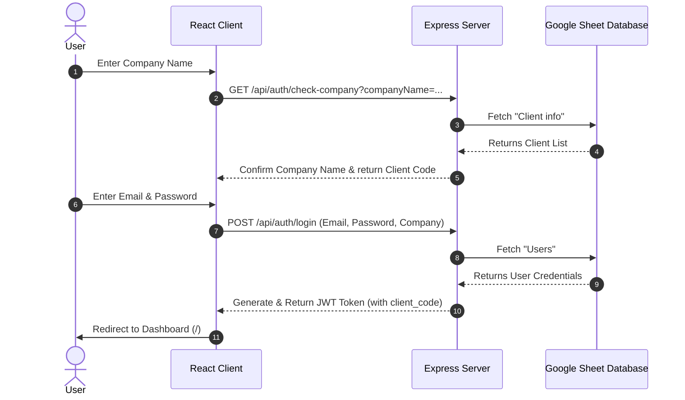
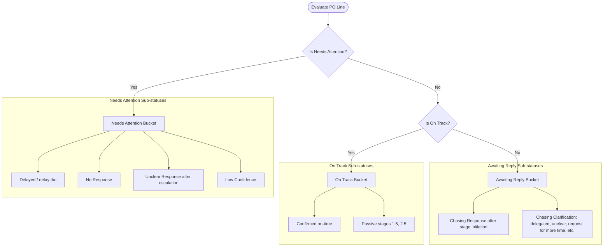

# Technical Architecture & PO Classification Documentation

This document serves as the comprehensive system specification for the Akisto Client Portal. It outlines user authentication, page-by-page workflows, APIs, mapped database sheets, and the core purchase order (PO) classification logic.

---

## 1. Authentication & Login Workflow

The login flow operates as a two-step validation sequence to authenticate users and bind sessions to a specific client company code (`client_code`).



### 1.1 Step 1: Company Check
* **Frontend Component:** `Login.jsx` (`handleCheckCompany`)
* **Backend Endpoint:** `GET /api/auth/check-company`
* **Internal Logic:** Finds the client configuration by matching the input name against possible client name fields in the spreadsheet.
* **Sheets & Columns Mapped:**
  * **Sheet:** `Client info`
  * **Columns:**
    * `client_company_name` / `company_name` / `client_company_name_full` (Used for name matching)
    * `client_code` (Retrieved identifier used to bind the session)

### 1.2 Step 2: Sign In & Session Generation
* **Frontend Component:** `Login.jsx` (`handleLogin`)
* **Backend Endpoint:** `POST /api/auth/login`
* **Internal Logic:** Validates the user email, matches password hash (supports bcrypt and fallback SHA-256/Plaintext), checks if the account is active, and signs a JSON Web Token (JWT) containing user identifiers and client privileges.
* **Sheets & Columns Mapped:**
  * **Sheet:** `Users`
  * **Columns:**
    * `email` (Used for user lookup)
    * `client_code` (Ensures the user belongs to the checked company)
    * `password_hash` / `password` / `password_hash_` (Used for credential validation)
    * `active` (Checks if account status matches: `TRUE`/`YES`/`Y`/`1` or is blank)
    * `User Name` / `userName` (Retrieved for profile UI)
    * `Role` / `userRole` (Retrieved for role-based permissions)

---

## 2. Dashboard Pages Workflow & API Mapping

Once authenticated, the frontend uses the JWT in authorization headers to communicate with the backend. Below is the technical breakdown of each route.

### 2.1 Dashboard Page (`/` / `/dashboard`)
Presents a status dashboard showing high-level KPIs (Total open PO lines, On Track count, Needs Attention count, Awaiting Reply count) and a filterable table of open orders.

* **API Endpoints:**
  * `GET /api/dashboard/summary` (Returns KPIs)
  * `GET /api/dashboard/data` (Returns PO records grouped by status bucket)
* **Backend Controller:** `dashboard.controller.js`
* **Internal Logic:**
  1. Retrieves all rows from both sheets and filters them by the user's `client_code`.
  2. Joins `PO consolidated data` with `Communication Logs` using `po_line_key` as the primary key.
  3. Sequentially evaluates each merged record against the bucketing algorithm rules.
  4. Returns lists divided into `onTrack`, `needsAttention`, and `awaitingReply`.
* **Sheets & Columns Mapped:**
  * **Sheet 1:** `PO consolidated data` (provides PO attributes like `po_number`, `supplier_name`, `ship_by_band`, `issue_date`)
  * **Sheet 2:** `Communication Logs` (provides outreach stage tracking, reply status, and classifications)
  * **Common Join Key:** `po_line_key`

---

### 2.2 PO Details Page (`/detail/:commsGroupId`)
Provides a line-by-line breakdown of a PO group, the full communication timeline, supplier contacts, raw replies, and AI classifications.

* **API Endpoint:** `GET /api/po/detail/:commsGroupId`
* **Backend Controller:** `po.controller.js`
* **Internal Logic:**
  1. Queries all line items matching the `comms_group_id` for the authenticated client.
  2. Resolves corresponding supplier contact details.
  3. Builds a chronological history of outreach timestamps, reminder emails, and replies.
  4. Parses the current follow-up stage status to output the next recommended action.
* **Sheets & Columns Mapped:**
  * **Sheet 1:** `PO consolidated data`
    * *Columns:* `comms_group_id`, `po_number`, `supplier_name`, `supplier_code`, `po_status`, `ship_by_band`, `issue_date`, `po_line_item`, `material_code`, `material_name`, `quantity`, `unit_of_measure`, `ship_by_date_delivery_1`, `deliver_by_date_delivery_1`.
  * **Sheet 2:** `Material and Supplier Master Data` (Supplier contacts mapping)
    * *Columns matched on `supplier_code`:* `supplier_name`, `primary_contact_names`, `primary_emails`, `primary_phones`, `working_days`, `supplier_source_location`, `delivery_location`, `client_buyer_name`, `client_buyer_email`.
  * **Sheet 3:** `Communication Logs` (Timeline and Raw statements)
    * *Columns matched on `comms_group_id`:* `follow_up_stage`, `follow_up_status`, `stage1_outreach_timestamp`, `stage2_outreach_timestamp`, `stage3_outreach_timestamp`, `stage[1,2,3]_reminder_mail[1,2,3]_timestamp`, `stage1_reply_timestamp`, `stage2_reply_timestamp`, `stage3_reply_timestamp`, `stage1_supplier_raw_statement`, `stage2_supplier_raw_statement`, `stage3_supplier_raw_statement`, `stage1_delivery_status_classification`, `stage2_delivery_status_classification`, `stage3_delivery_status_classification`.

---

### 2.3 Supplier Performance Page (`/supplier-performance`)
Shows high-level metrics of suppliers, trend lines of historical performance, and charts indicating reason categories for late orders.

* **API Endpoint:** `GET /api/supplier/performance`
* **Backend Controller:** `supplier.controller.js` (`getSuppliers`)
* **Internal Logic:**
  1. Filters data by the client code and scopes results to the buyer associated with the logged-in email.
  2. Aggregates and ranks suppliers based on their overall on-time rate (OTR).
  3. Dynamically calculates OTR trend lines per month.
  4. Aggregates delay counts by category to draw the cause analysis charts.
* **Sheets & Columns Mapped:**
  * **Sheet 1:** `Supplier Stats` (Overall metrics)
    * *Columns:* `client_code`, `supplier_code`, `supplier_name`, `category`, `total_po_lines`, `on_time_rate`, `avg_days_late`, `avg_response_time_days`, `escalated_rate`, `performance_flag`, `buyer_name`, `on_time_lines`, `escalated_lines`.
  * **Sheet 2:** `Supplier Monthly Stats` (Monthly historical OTR trend)
    * *Columns:* `client_code`, `supplier_code`, `month`, `on_time_lines`, `total_po_lines`, `on_time_rate`.
  * **Sheet 3:** `Delay Event Logs` (Late delivery reasons)
    * *Columns:* `client_code`, `supplier_code`, `delay_reason_category`, `delay_origin`.
  * **Sheet 4:** `Client info` (Resolves the internal buyer's name from email logs)
    * *Columns:* `client_code`, `buyer_email` / `ai_agent_buyer_email`, `buyer_name` / `ai_agent_buyer_name`.

---

### 2.4 Supplier Details Page (`/supplier-detail/:supplierId`)
Provides a deep-dive performance dashboard for an individual supplier, illustrating their statistics against the buyer's global averages, along with a log of closed order histories.

* **API Endpoint:** `GET /api/supplier/detail/:supplierId`
* **Backend Controller:** `supplier.controller.js` (`getSupplierByCode`)
* **Internal Logic:**
  1. Gathers master stats, monthly timeline datasets, and delay logs for the specific supplier code.
  2. Computes the benchmark trend line by averaging metrics from all suppliers assigned to the same buyer.
  3. Gathers all lines from `Communication Logs` matching the supplier that are marked `"Closed"`.
* **Sheets & Columns Mapped:**
  * **Sheet 1:** `Supplier Stats` (`supplier_code`, `client_code`, `contact_name`, `email`, `phone`, `source_location`).
  * **Sheet 2:** `Supplier Monthly Stats` (`client_code`, `supplier_code`, `month`, `on_time_lines`, `total_po_lines`).
  * **Sheet 3:** `Delay Event Logs` (`client_code`, `supplier_code`, `delay_reason_category`, `delay_origin`).
  * **Sheet 4:** `Communication Logs` (Delivery log history)
    * *Columns:* `client_code`, `supplier_code`, `PO line item status` (Must equal `"Closed"`), `delivery_variance_days` (Maps delivery variance), `po_number`, `material_code`, `material_name`, `deliver_by_date`, and final stage reply timestamps (Used to resolve actual delivery date).

---

## 3. Purchase Order Bucketing & Classification Rules

The system maps each PO line into one of the three primary dashboard buckets based on the current follow-up stage, classification status, and escalation records.



### 3.1 Bucket: On Track (`onTrack`)
This bucket represents POs that are currently running smoothly according to plan, or are in quiet passive milestones with no follow-ups required yet.

* **Eligibility Criteria** (Triggers if **NOT** Needs Attention, **AND** one of the following is true):
  1. **Active Stage (`Stage1`, `Stage2`, `Stage3`)**:
     * Current stage classification is one of: `['on time', 'on time tbc', 'shipped tbc']`.
  2. **Passive Monitoring Stage (`Stage1.5`, `Stage2.5`)**:
     * *No reply received yet* (e.g. outreach has passed but passive stage is quietly monitoring) $\rightarrow$ counts as **On Track**.
     * *Reply received* $\rightarrow$ classification must match: `['on time', 'on time tbc', 'shipped tbc']`.
* **Sub-status Resolution:**
  * **`Confirmed`:** Standard verified on-time response.
  * **`Monitoring`:** Passive milestones (Stage 1.5/2.5) before any new reply or outreach is initiated.
* **Mapped Sheets & Columns:**
  * **Sheet:** `Communication Logs`
  * **Columns:** `follow_up_stage`, `follow_up_status`, `[stage]_reply_timestamp`, `[stage]_supplier_reply_status`, `[stage]_delivery_status_classification`.

---

### 3.2 Bucket: Awaiting Reply (`awaitingReply`)
This bucket represents open POs where outreach has started and the system is actively waiting for a response, or is engaging in active clarification with the supplier.

* **Eligibility Criteria:**
  * Default fallback for any open PO that does not qualify for **Needs Attention** or **On Track** (including POs with ambiguous or unclear replies that are still within clarification loops before escalation).
* **Sub-status Resolution:**
  * **`Chasing Response` (After Stage Initiation):** Outreach has been sent for the active stage (Stage 1, 2, or 3) and the system is waiting for the initial reply or running through automated reminders.
  * **`Clarification Sent` (Chasing Clarification):** Triggered when the supplier replies with an ambiguous or unclear response (`"Unclear"` classification). The system sends a clarification request, setting the dashboard status to `"Clarification Sent"`.
  * **`Delegated to Colleague` (Chasing Clarification):** Supplier reply is `"Unclear"` or `"awaiting_reply"`, and it is noted that the contact has been delegated to another person (supplier colleague's email is present).
  * **`Promised Check Date` (Chasing Clarification):** Supplier reply is `"Unclear"` or `"awaiting_reply"`, and they have requested more time (a promised date is set in the revert fields).
* **Mapped Sheets & Columns:**
  * **Sheet:** `Communication Logs`
  * **Columns:** `follow_up_stage`, `follow_up_status`, `supplier_colleague_email`, `promised_revert_date`, `[stage]_promised_revert_date`, `[stage]_delivery_status_classification`.

---

### 3.3 Bucket: Needs Attention (`needsAttention`)
This bucket holds POs requiring immediate human review due to delays, non-responsiveness, low extraction confidence, or failed automated clarifications.

* **Eligibility Criteria** (Triggers if **ANY** of the following are true for the current stage prefix):
  1. `needs_human_review` is `"Yes"` (case-insensitive).
  2. `human_review_status` is `"Pending"` (case-insensitive).
  3. `follow_up_status` is `"escalation_sent"`.
  4. The current stage's classification contains `"delay"` or `"late"` (case-insensitive).
  5. The current stage's reply confidence is `"Low"` (case-insensitive).
* **Sub-status Resolution (The 4 Categories of Needs Attention):**
  1. **`Delayed`** (or `delay tbc`): Triggered when classification contains `"delay"` or `"late"`.
  2. **`No Response`:** Triggered when the automated chasing sequence (from outreach through reminders) has run its course without a reply (the status is set to `"escalation_sent"`).
  3. **`Unclear Response (after escalation)`:** Triggered when the supplier replies but the text is `"Unclear"`. After sending two automated clarification emails with no clear response, n8n exhausts the follow-ups and escalates to the buyer (`follow_up_status` becomes `"escalation_sent"`).
  4. **`Low Confidence`:** Triggered when the AI extracts info from a reply but flags it with `"Low"` confidence, activating the n8n **Freeze Guard** to halt automated actions.
* **Mapped Sheets & Columns:**
  * **Sheet:** `Communication Logs`
  * **Columns:** `needs_human_review`, `human_review_status`, `follow_up_status`, `[stage]_delivery_status_classification`, `[stage]_supplier_reply_confidence`.

---

## 4. Excel Summary Statistics Sheet Formulas

The sheet **`Supplier Stats`** aggregates metrics per supplier. These metrics are dynamically calculated from the transactional **`Communication Logs`** using the following Excel formulas:

### 4.1 Total PO Lines
```text
=COUNTIFS('Communication Logs'!B:B, A2, 'Communication Logs'!F:F, B2)
```
*Counts all rows in `Communication Logs` matching the client code (`Column A`) and supplier code (`Column B`).*

### 4.2 On-Time Lines
```text
=COUNTIFS('Communication Logs'!B:B, A2, 'Communication Logs'!F:F, B2, 'Communication Logs'!GT:GT, "<=0", 'Communication Logs'!K:K, "Closed")
```
*Counts closed PO lines where `delivery_variance_days` (Column `GT`) is $\le 0$ (on time or early).*

### 4.3 On-Time Rate (OTR)
```text
=IF(L2>0, M2/L2, 1.0)
```
*Divides `On-Time Lines` by `Total PO Lines`. Defaults to 100% if no lines are recorded.*

### 4.4 Average Days Late
```text
=IFERROR(AVERAGEIFS('Communication Logs'!GT:GT, 'Communication Logs'!B:B, A2, 'Communication Logs'!F:F, B2, 'Communication Logs'!GT:GT, ">0"), 0)
```
*Averages only the positive (late) values of `delivery_variance_days` (Column `GT`) for the supplier.*

### 4.5 Performance Flag
```text
=IF(N2<0.6, "Watch", IF(N2<0.8, "Review", ""))
```
*Assigns a **Watch** flag if the OTR is $< 60\%$, a **Review** flag if it is $60\% - 79\%$, and no flag if it is $\ge 80\%$.*
